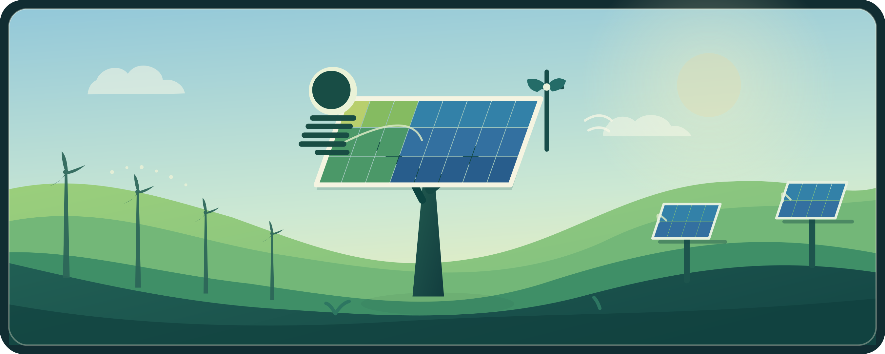

<div align="center">

<picture>
  <source media="(prefers-color-scheme: dark)" srcset="branding/banners/estacion-meteorologica-banner.png" />
  
</picture>

# Estación Meteorológica

**Del sensor al dato: monitoreo ambiental de bajo costo.**

[](#resumen-ejecutivo) [](docs/academica/README.md) [](LICENSING.md)

[](#qué-incluye) [](#qué-incluye) [](#ejecutar-la-parte-web) [](#qué-incluye)

[Documentación](docs/README.md) · [Arquitectura](docs/tecnica/01-arquitectura.md) · [Manual de uso](manual-de-usuario.md) · [Informe académico](docs/academica/README.md)

</div>

## Resumen ejecutivo

Estación Meteorológica es un prototipo educativo de monitoreo ambiental. Un ESP32-S3 captura temperatura, humedad, presión, CO₂ y posición GPS; un servidor local valida y guarda las mediciones en JSONL, y un panel web permite consultar series, reconocer cambios bruscos y exportar datos en CSV o JSONL.

El proyecto permite estudiar el recorrido completo de una medición, desde el sensor hasta su análisis. Su alcance actual es local y experimental; para uso científico o en exteriores requiere calibración y ensayos del montaje.

## Origen

El proyecto nació como trabajo grupal de **Ingeniería y Desarrollo Sustentable** en la Universidad Católica del Norte, orientado a la Región de Coquimbo. Diseñé el circuito y programé el firmware Arduino durante la asignatura; después desarrollé el backend y el frontend web actuales como continuación personal. El [contexto académico y los créditos](docs/academica/README.md) describen las contribuciones del equipo y reúnen el informe final de 2025.

## Qué incluye

| Capa         | Implementación                                                                            |
| ------------ | ----------------------------------------------------------------------------------------- |
| Captura      | ESP32-S3 con BME280, DHT22, SCD4x y GPS; lectura, agregación y filtro de cambios bruscos. |
| Comunicación | Punto de acceso Wi-Fi del ESP32 y envío HTTP JSON al PC.                                  |
| Servidor     | Node.js 24 y Express 5; recepción, validación y registro de mediciones.                   |
| Persistencia | Archivo JSONL y ventana de hasta 1000 registros en memoria.                               |
| Consulta     | Dashboard HTML/CSS/JavaScript con indicadores, gráficos y exportación CSV/JSONL.          |

El firmware actual no mide PM₂.₅/PM₁₀. La alimentación solar del esquema es una propuesta de diseño; el sistema funciona en red local y su API carece de autenticación. Consulta las [funciones y limitaciones](docs/general/02-estado-del-prototipo.md).

## Ejecutar la parte web

Requiere **Node.js >=24.21.0 y <25**, con npm. Desde la raíz del repositorio:

```bash
cd backend
npm ci
npm run start:dev
```

Abre [localhost:3002](http://localhost:3002). El modo de desarrollo muestra el archivo configurado y recibe mediciones por POST; no genera muestras automáticamente. Antes de enviar datos de prueba, configura un `DATA_FILE` independiente en `backend/.env`, siguiendo [`.env.example`](backend/.env.example).

Para recibir datos del ESP32, usa `npm run start:esp32` (puerto predeterminado 3001) y configura la red y la URL del firmware. Sigue la [guía de uso](docs/general/03-uso-y-recorrido.md), el [montaje](firmware/README.md) y la [configuración del backend](backend/README.md).

## Documentación

| Área                                                   | Contenido                                                 |
| ------------------------------------------------------ | --------------------------------------------------------- |
| [General](docs/general/01-proposito-y-alcance.md)      | Propósito, funciones y uso.                               |
| [Técnica](docs/tecnica/01-arquitectura.md)             | Arquitectura, hardware, datos, API, algoritmos y pruebas. |
| [Desarrollo](docs/desarrollo/01-evolucion-y-metodo.md) | Decisiones y próximos pasos.                              |
| [Académica](docs/academica/README.md)                  | Informe original, contexto y contribuciones.              |

[Índice completo](docs/README.md) · [Identidad visual](branding/README.md) · [Contribuir](CONTRIBUTING.md) · [Historial de cambios](CHANGELOG.md).

## Licencia y créditos

Código propio bajo [ISC](LICENSE). Los informes, imágenes, bibliotecas y recursos de terceros conservan sus condiciones. Consulta [licencia, créditos y reutilización](LICENSING.md).
