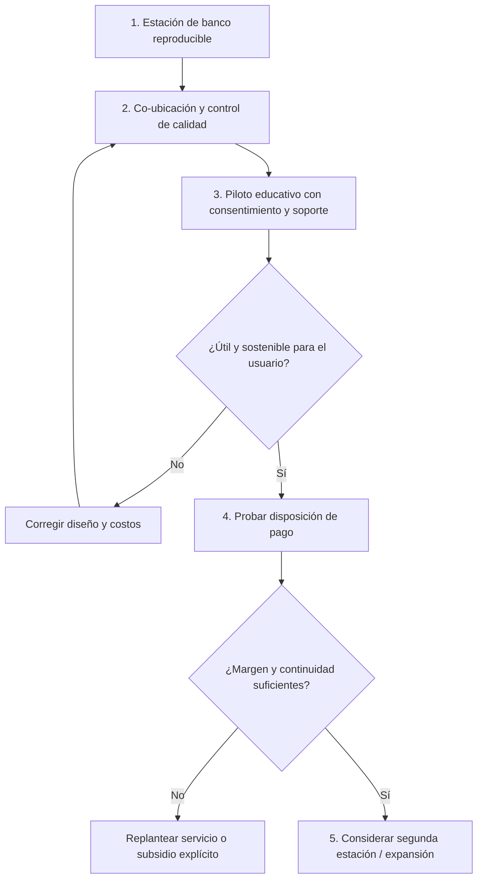

# 04 · Pilotos, clientes y posibles servicios: validar antes de escalar

[← Desarrollo](../README.md) · [Viabilidad y costos](03-viabilidad-economica-y-sostenibilidad.md) · [Validación experimental](../tecnica/08-evidencia-y-validacion-experimental.md) · [Origen académico](../academica/README.md)

> **Hoja de ruta estratégica, no compromiso institucional ni cartera de clientes.** No hay convenios, ventas, pilotos externos, financiación, autorizaciones de UCN/colegios/municipios, proyectos públicos adjudicados o contratos de mantenimiento documentados. El informe de 2025 propone un piloto y una futura red: no prueba que estos se ejecutaran.

## Un segmento pequeño, un servicio verificable

La propuesta no debería comenzar por «vender una red de estaciones» sino por descubrir **qué necesita de verdad quien usará los datos**. Una institución educativa puede valorar una experiencia práctica de IoT; un laboratorio puede necesitar más continuidad y trazabilidad; una comunidad puede interesarse en tendencias indicativas. Son necesidades y presupuestos distintos.

| Segmento a entrevistar | Trabajo que quiere resolver | Producto/servicio mínimo posible | Prueba que autoriza avanzar |
| --- | --- | --- | --- |
| Docente o tallerista STEM | Explicar sensores, redes y visualización con un caso concreto | Kit, instalación demostrativa y dos guías de actividad | Sesión observada, comprensión del alumnado y costo completo |
| Laboratorio universitario | Repetir prácticas de adquisición y validación | Estación de banco, API, ejemplos y material de QA/QC | Ensayo, soporte necesario y reproducibilidad independiente |
| Agrupación de ciencia ciudadana | Entender variaciones locales **no regulatorias** | Serie indicativa con metadatos, revisiones y advertencias | Protocolo de co-ubicación, continuidad y acuerdo de publicación |
| Institución/servicio técnico | Integrar sensores y tablero en un contexto definido | Proyecto a medida con mantenimiento delimitado | Contrato, permisos y garantías acordadas; seguridad corregida |

**No ofertar la versión actual como sistema oficial de calidad del aire ni como estación exterior autónoma.** Su firmware aún no mide partículas; no hay protección meteorológica ni validación científica suficiente para ese uso.

## Puertas de validación

**Cada flecha representa una condición, no un hito realizado.** Los criterios concretos se definen antes de medir, según el caso de uso y sus riesgos.

## Ruta inicial de pruebas de mercado

1. **Conversaciones de problema:** entrevistar docentes y responsables de laboratorios; preguntar por disponibilidad, fallos, mantenimiento, alternativas y restricciones de presupuesto antes de mostrar el producto.
2. **Prototipo didáctico supervisado:** llevar la estación de banco **solo después de comprobar seguridad eléctrica y datos suficientes**. Entregar instrucciones reproducibles y registrar dudas de quien no diseñó el sistema.
3. **Prueba de calidad:** registrar condiciones, frecuencia, fallos, comparación contra instrumentos adecuados y datos crudos.
4. **Cotización completa:** facturas, horas, carcasa, consumibles, soporte, seguridad, electricidad, capacitación y reposiciones.
5. **Piloto pagado — si existe interés real:** negociar alcance y derechos. Registrar **precio efectivamente cobrado**, costos y obligaciones; no contabilizar compromiso verbal como ingreso.
6. **Decisión de escala:** si se cumplen calidad, rentabilidad y utilidad, explorar 2–3 nodos **con identificación por dispositivo y gestión de integridad**. El backend actual no distingue estaciones, por lo que **no debe simplemente duplicarse el número de ESP32 y mezclar las mediciones**.

## Modelo operativo por caso de uso

| Actividad | Kit educativo | Servicio de instalación | Red ambiental futura |
| --- | --- | --- | --- |
| Fabricación y compra | Necesarias | Necesarias | Necesarias y escalables |
| Calibración de referencia | Según finalidad pedagógica | Según precisión acordada | Esencial para la pregunta ambiental |
| Internet o nube | No obligatorios | Dependientes del contrato | Arquitectura nueva por analizar |
| Soporte y capacitación | Principal fuente de valor | Entregable con SLA delimitado | Mantenimiento recurrente indispensable |
| Contratos y responsabilidad | Licencias de contenidos y seguridad | Términos, garantía, protección de datos | Permisos, calidad, acceso público y gobernanza |
| Métrica de éxito | Aprendizaje útil / costo por actividad | Margen real y satisfacción | Cobertura temporal/espacial y calidad verificadas |

**Estrategia comercial recomendada por la auditoría:** probar **servicios alrededor de un kit educativo o laboratorio** antes de prometer una red pública. Los usos comunitarios son valiosos, pero no garantizan rentabilidad ni equivalen a obligaciones comerciales de municipios.

## Cómo comparar costos contra alternativas sin engañarnos

No usar «el hardware vale $100.000» como sustituto del costo de una estación profesional. Preparar una matriz de **igual función, igual duración, igual tolerancia, mismo alcance y mismo soporte**, indicando que la estación actual no mide PM, viento o precipitación. Comparar educación con otros **kits educativos**, y calidad normativa con instrumentos adecuados **sin presentarse como equivalente**.

La comparación válida deberá registrar **precio puesto en Chile, IVA, montaje, instrumentos auxiliares, formación, reparación, software, acceso a datos y tiempo docente o técnico**. Requerirá cotizaciones vigentes y características cotejables.

## Criterios de salida

- **Técnico:** repetibilidad, fallos identificados y restauración del flujo desde el sensor.
- **Pedagógico:** aprendizaje verificable y manejo autónomo por otra persona.
- **Económico:** precio neto real menos costo unitario total positivo, y demanda suficiente para cubrir costos fijos cuando corresponda.
- **Ambiental:** mantenimiento responsable, consumo medido, vida útil y residuos electrónicos; no confundir solar previsto con impacto demostrado.
- **Legal y ético:** atribución académica precisa, licencias correctas, permisos de sitio e información de ubicación bajo control.

Si alguna condición falla, **reducir alcance o mantenerlo como prototipo formativo** es un resultado válido, no un fracaso. El objetivo original universitario puede estar cumplido como ejercicio de ingeniería sin demostrar una empresa rentable.

[Escenario financiero y fórmulas](03-viabilidad-economica-y-sostenibilidad.md) · [Plan de pruebas](../tecnica/08-evidencia-y-validacion-experimental.md).
