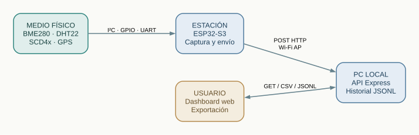
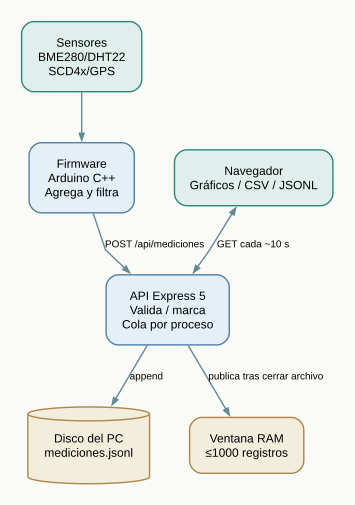
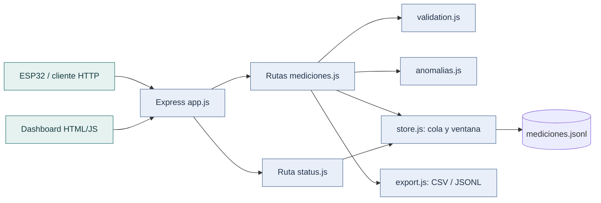
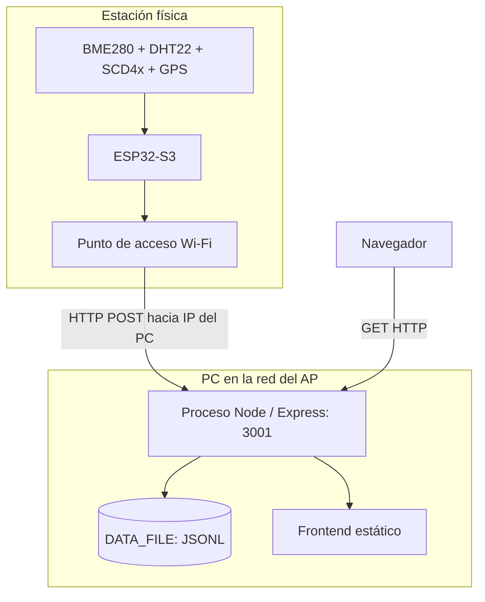

# 01 · Arquitectura del sistema

La estación combina captura en un ESP32-S3, recepción y almacenamiento en un PC, y consulta desde el navegador. Los diagramas describen el sistema local en cuatro niveles: contexto, contenedores, componentes y despliegue.

## Nivel 1 — Contexto

- Los sensores físicos aportan lecturas al ESP32-S3.
- El **PC** recibe y almacena los datos; no es el microcontrolador quien escribe el historial JSONL.
- El usuario accede al dashboard desde un navegador. Las operaciones HTTP carecen de autenticación de aplicación.

## Nivel 2 — Contenedores y comunicación

| Contenedor        | Responsabilidad                                                                  | Fuente                                                                                        |
| ----------------- | -------------------------------------------------------------------------------- | --------------------------------------------------------------------------------------------- |
| Firmware ESP32-S3 | Lectura I²C/GPIO/UART, agregación, filtro y POST JSON por Wi-Fi AP.              | [`EstacionMeteorologica.ino`](../../firmware/EstacionMeteorologica/EstacionMeteorologica.ino) |
| Backend Express   | Contrato HTTP, validación, anomalías, cola de escrituras, lectura y exportación. | [`src/app.js`](../../backend/src/app.js)                                                      |
| Historial         | Archivo JSON Lines en disco local del PC.                                        | [`src/store.js`](../../backend/src/store.js)                                                  |
| Dashboard         | Módulos web estáticos con consulta periódica y gráfico Canvas.                   | [`frontend/assets/js/`](../../backend/frontend/assets/js/)                                    |

## Nivel 3 — Componentes del servidor

Las rutas de mediciones llaman a `export.js` para leer el archivo completo. Las consultas recientes utilizan la ventana de memoria de `store.js`.

## Nivel 4 — Despliegue físico y lógico

**Modos de arranque:** `start:dev` usa el puerto 3002 y `start:esp32` el 3001. Ambos sirven la misma API y el mismo dashboard; el modo dev permite trabajar sin hardware mediante POST de prueba. El puerto y la interfaz de escucha son configurables. `BACKEND_URL` debe apuntar a la IP real del PC en la red del ESP32.

## Límites arquitectónicos

No existe broker MQTT, WebSocket, base SQL, sincronización, nube ni registro multiestación. Un corte de red puede perder entregas: el firmware no mantiene una cola durable de reintento. El backend garantiza orden entre **sus propios POST concurrentes** mediante una cola en proceso, no una transacción distribuida ni durabilidad ante apagones. Una ejecución simultánea de dos procesos sobre el mismo archivo no está protegida por bloqueos entre procesos.

Para seguir una petición de extremo a extremo: [flujos](05-flujos-y-estados.md); para conocer las reglas: [calidad y algoritmos](06-calidad-y-algoritmos.md).
