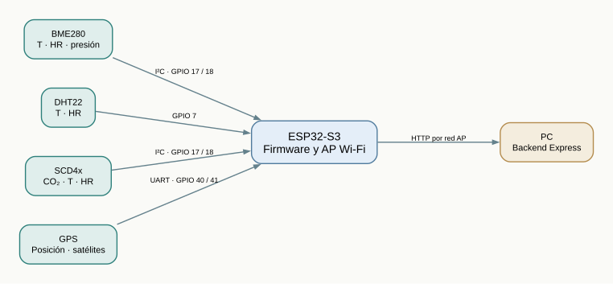
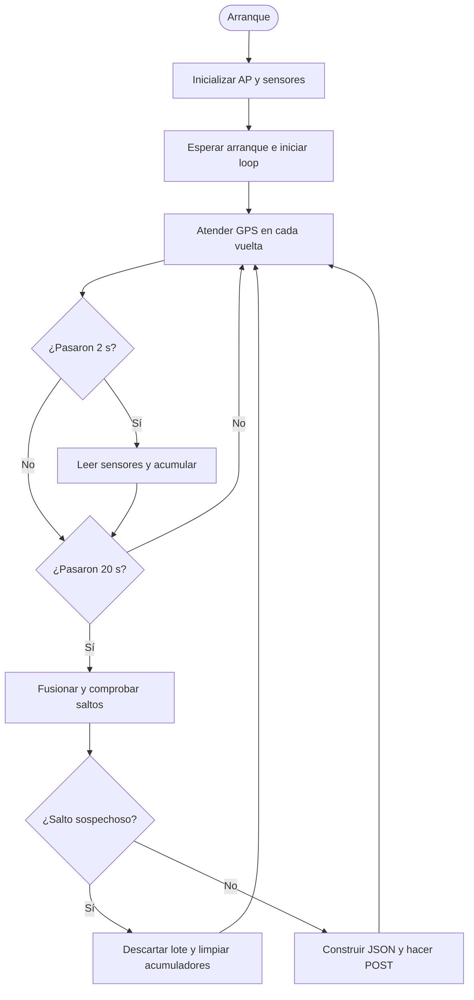

# 02 · Hardware, conexiones y firmware

El montaje combina un ESP32-S3 con tres sensores ambientales y un GPS. La tabla resume los pines definidos en [`config.h`](../../firmware/EstacionMeteorologica/config.h); revisa su correspondencia con el cableado antes de conectar la placa.

| Componente | Bus / pin                                  | Función                                      |
| ---------- | ------------------------------------------ | -------------------------------------------- |
| **BME280** | I²C: SDA GPIO 17, SCL GPIO 18              | Temperatura, humedad y presión atmosférica.  |
| **DHT22**  | GPIO 7                                     | Temperatura y humedad de referencia.         |
| **SCD4x**  | I²C: GPIO 17/18                            | Concentración de CO₂, temperatura y humedad. |
| **GPS**    | UART: RX GPIO 40, TX GPIO 41; 9600 baudios | Coordenadas y número de satélites.           |

[Esquema original editable (`.drawio`)](../../diagramas/circuito.drawio) · [Imagen del esquema](../../diagramas/circuito.png).

**Energía:** el esquema propone panel solar → TP4056 → batería → regulador → placa. **Es una propuesta**, no un sistema solar validado. Faltan potencia media y de pico medida, selección de protecciones compatibles, ciclo de carga, dimensionamiento y pruebas de autonomía. Antes de alimentar la placa con baterías de litio, validar el diseño, los componentes y la seguridad eléctrica.

**Alcance ambiental:** el firmware actual **no integra un sensor de PM₂.₅/PM₁₀**, aunque esa variable se propuso en el informe académico. Tampoco se documentan sensores de lluvia o de viento. Por lo tanto, no debe promocionarse como estación meteorológica profesional completa ni como monitor reglamentario de contaminación. [Contraste con el LaTeX](../academica/02-lectura-critica-del-informe.md).

## Programa y cadencia

Configuración actual: **espera inicial 10 s**, **lectura cada 2 s** y **agregación/envío cada 20 s**. Los nombres históricos de funciones como `procesarMinuto` no cambian el intervalo configurado. La latencia de sensores, GPS, HTTP y bucle puede alterar los tiempos efectivos.

## Decisiones que afectan la medición

La temperatura y humedad provienen de una **fusión**: si hay al menos dos lecturas válidas y su rango queda dentro del umbral de coherencia, se calcula una media; de lo contrario se prioriza **SCD4x → BME280 → DHT22**. La presión se toma del BME280; el CO₂, del SCD4x. Para GPS, el programa promedia coordenadas válidas del intervalo. El dato sin lectura puede expresarse como `null`; CO₂ igual a cero se usa como ausencia de muestras en la interpretación actual.

Los valores `incertidumbre_*` son **estimaciones heurísticas** (p. ej., mitad del rango o una base fija por sensor), no resultados de calibración ni intervalos estadísticos certificados. El detalle cuantitativo está en [algoritmos](06-calidad-y-algoritmos.md).

## Compilación y ensayo

El perfil [`sketch.yaml`](../../firmware/EstacionMeteorologica/sketch.yaml) fija core y librerías; consulta versiones y comando exacto en [firmware/README.md](../../firmware/README.md). Compilar no confirma conexión eléctrica, recepción GPS, precisión o autonomía. Antes de un uso prolongado faltan pruebas físicas reproducibles, revisión térmica y de energía, y comparación con instrumentos de referencia. El archivo histórico tiene registros fuera de rango: [auditoría experimental y protocolo](08-evidencia-y-validacion-experimental.md). La [viabilidad económica](../desarrollo/03-viabilidad-economica-y-sostenibilidad.md) tampoco puede calcularse con un diagrama de cableado sin inventario y medidas de consumo.
