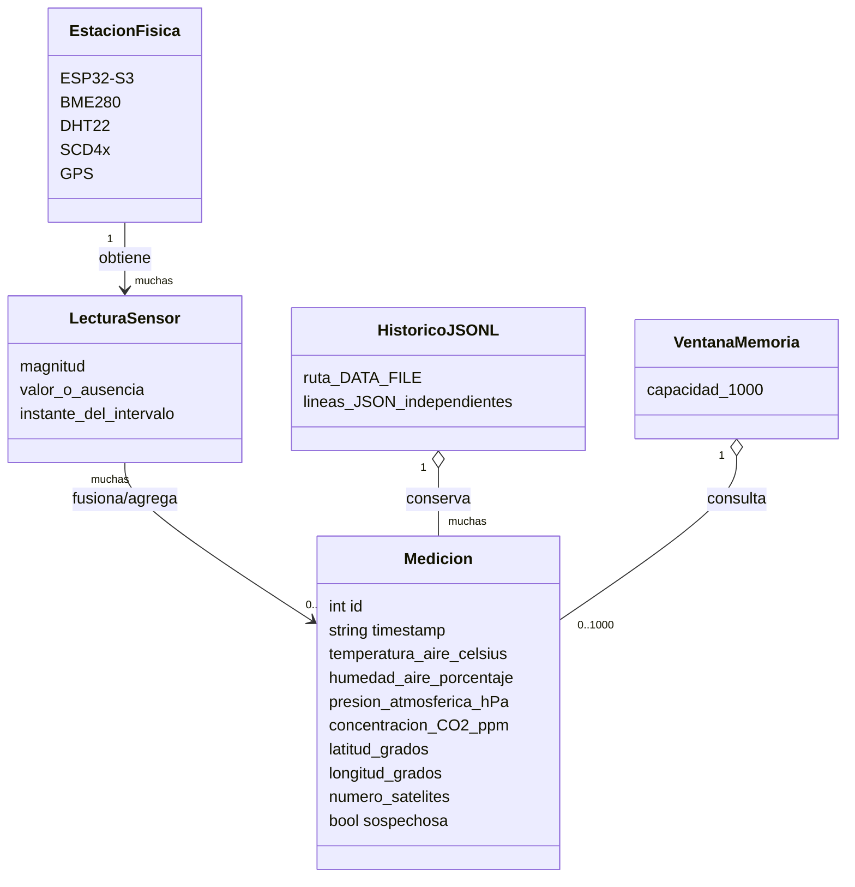
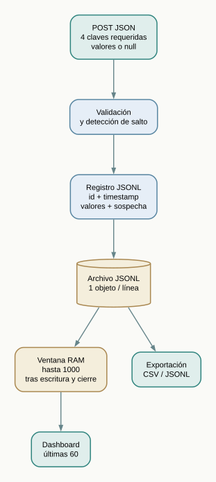

# 03 · Datos, dominio y persistencia

El backend almacena las mediciones en **JSON Lines (JSONL)**, una por línea, y conserva las últimas **1000** en memoria para consultas recientes.

## Modelo de dominio



`EstacionFisica` y `LecturaSensor` representan la adquisición; el archivo conserva únicamente registros de mediciones agregadas. Estos registros carecen de identidad de estación y de lecturas individuales de temperatura y humedad por sensor.

## Esquema lógico del archivo



Cada POST válido contiene las cuatro magnitudes obligatorias por **presencia de clave** (se admite `null`): `temperatura_aire_celsius`, `humedad_aire_porcentaje`, `presion_atmosferica_hPa`, `concentracion_CO2_ppm`. Son opcionales las dos incertidumbres, latitud, longitud y número de satélites. El backend rechaza campos desconocidos.

El servidor añade `id`, `timestamp` en UTC al procesar el registro en la cola y `sospechosa`; si hay cambios bruscos añade `motivos_sospecha`. La fecha corresponde al registro en el servidor. Ejemplo sintético:

```json
{
  "id": 1,
  "timestamp": "2026-01-01T12:00:00.000Z",
  "temperatura_aire_celsius": 22.4,
  "incertidumbre_temperatura_celsius": 0.2,
  "humedad_aire_porcentaje": 48.5,
  "incertidumbre_humedad_porcentaje": 1.4,
  "presion_atmosferica_hPa": 1012.1,
  "concentracion_CO2_ppm": 570,
  "latitud_grados": null,
  "longitud_grados": null,
  "numero_satelites": 0,
  "sospechosa": false
}
```

| Campo            | Rango de admisión de API                 | Significado                               |
| ---------------- | ---------------------------------------- | ----------------------------------------- |
| Temperatura °C   | −50 a 85                                 | Valor fusionado.                          |
| Humedad %        | 0 a 100                                  | Valor fusionado.                          |
| Presión hPa      | 300 a 1200                               | BME280.                                   |
| CO₂ ppm          | 0 a 40000                                | SCD4x (0 puede indicar falta de muestra). |
| Latitud/longitud | −90 a 90 / −180 a 180                    | Puede faltar fijación GPS.                |
| Satélites        | entero 0 a 255                           | Número comunicado por GPS.                |
| Incertidumbres   | ≥0, con límites definidos en `config.js` | Estimaciones del firmware.                |

Los límites son filtros de entrada, **no rangos de exactitud**. La fuente de reglas es [`backend/src/config.js`](../../backend/src/config.js).

## Compatibilidad histórica del conjunto incluido

El archivo [`backend/data/mediciones.jsonl`](../../backend/data/mediciones.jsonl) contiene **43 registros históricos**, algunos **anteriores a la forma actual del modelo**: ninguno declara el campo `sospechosa`; los ID **26–28** incluyen **181,39 °C** y **−130,8 hPa**. **El backend valida nuevas entradas**, pero la recuperación de líneas históricas no aplica retrospectivamente todas las reglas de admisión vigentes. No borrar esos casos para simular una serie impecable: mantener datos originales y etiquetarlos analíticamente mediante herramientas de QA/QC.

La ausencia de coordenadas válidas en este archivo no permite afirmar que el GPS sea defectuoso. El timestamp corresponde al servidor y el archivo **no permite inferir precisión o completitud experimental**. [Auditoría reproducible y pruebas pendientes](08-evidencia-y-validacion-experimental.md).

## Escritura, recarga y exportación

1. En cada arranque, `store.js` recorre el JSONL; ignora líneas inválidas y recompone el total, el último registro, los IDs y la ventana reciente.
2. Una cola en el proceso serializa nuevas escrituras: calcula ID/anomalía, añade al archivo y cierra el descriptor **antes** de publicar en memoria y responder `201`.
3. Si falla una escritura, intenta truncar al tamaño anterior. Si esa restauración falla, bloquea nuevas escrituras y requiere intervención.
4. La consulta `GET /api/mediciones` trabaja sobre la ventana de memoria; la exportación CSV/JSONL recorre el **archivo completo**, con filtros temporales si se solicitan.

La implementación **no hace `fsync`**, no usa cierre transaccional con un motor SQL, no protege contra dos procesos escribiendo el mismo archivo y no garantiza integridad ante cortes de energía. La recarga no vuelve a validar retrospectivamente todos los rangos actuales.

**Privacidad:** el historial puede contener coordenadas. No publiques datos reales sin revisar qué revela su localización. La API `GET /api/status` expone incluso la ruta de `DATA_FILE` en su respuesta actual; es otra razón para limitar el servidor a una red controlada.
