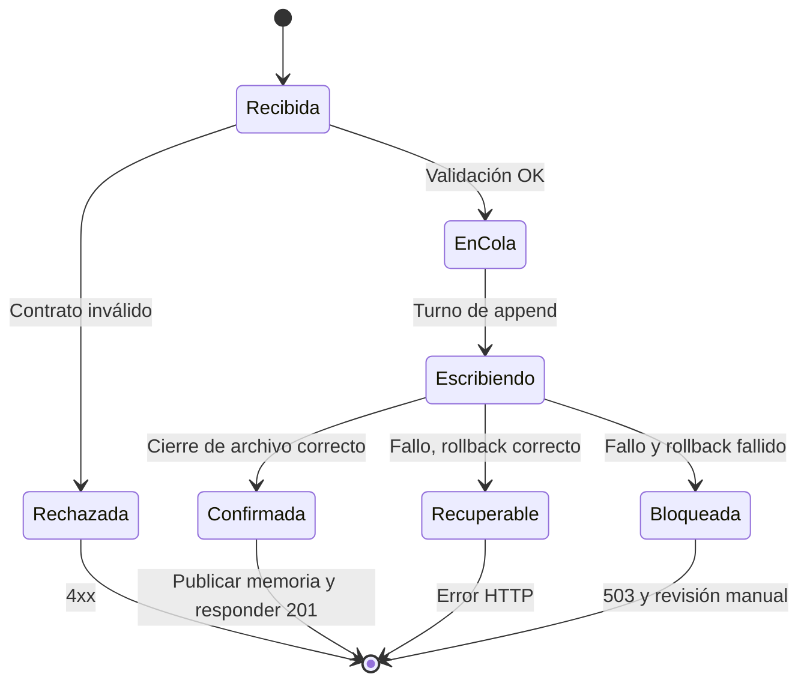
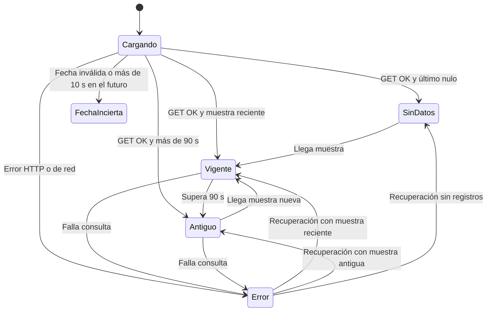
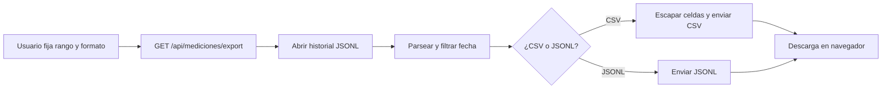

# 05 · Flujos, secuencias y estados

Los diagramas siguen la adquisición, la escritura y la consulta. El firmware realiza un intento de envío por lote aceptado y carece de cola durable de reintentos.

## Secuencia: de la muestra a `201`

```mermaid
sequenceDiagram
  participant S as Sensores
  participant E as ESP32-S3
  participant A as Express
  participant V as Validación y anomalías
  participant J as JSONL
  participant B as Navegador
  loop Cada ~2 s (según loop)
    E->>S: Leer sensores y GPS
    S-->>E: Valores / faltantes
  end
  E->>E: Agregar ~20 s y fusionar
  alt Salto sospechoso según firmware
    E->>E: Descartar lote (sin POST)
  else Lote no descartado
    E->>A: POST /api/mediciones (HTTP JSON)
    A->>V: Validar entrada y comparar con anterior
    V-->>A: Registro con ID, fecha y marca
    A->>J: Append en cola y cerrar archivo
    alt Escritura confirmada
      J-->>A: OK
      A->>A: Publicar en memoria
      A-->>E: 201 con registro
    else Error de escritura
      J-->>A: Error
      A-->>E: 500 o 503
    end
  end
  B->>A: GET /api/status y /api/mediciones?limit=60
  A-->>B: Estado y ventana reciente
  B->>B: Mostrar datos y vigencia
```

## Máquina de estados: un intento de ingreso (backend)

`Bloqueada` corresponde a la variable interna `writeBlocked` del proceso. No hay una tabla persistente con esos estados ni un sistema de reintentos automáticos.

## Máquina de estados: lo que ve el dashboard

El frontend conserva los valores previos cuando la consulta falla, **sin presentarlos como datos actuales**. DHT22 no se verifica individualmente desde el backend. Fuente: [`state.mjs`](../../backend/frontend/assets/js/state.mjs) y [`render.mjs`](../../backend/frontend/assets/js/render.mjs).

## Flujo de exportación

No hay filtrado ni paginación por base SQL. La lectura de exportación es secuencial y omite líneas que no contienen objetos JSON válidos.
