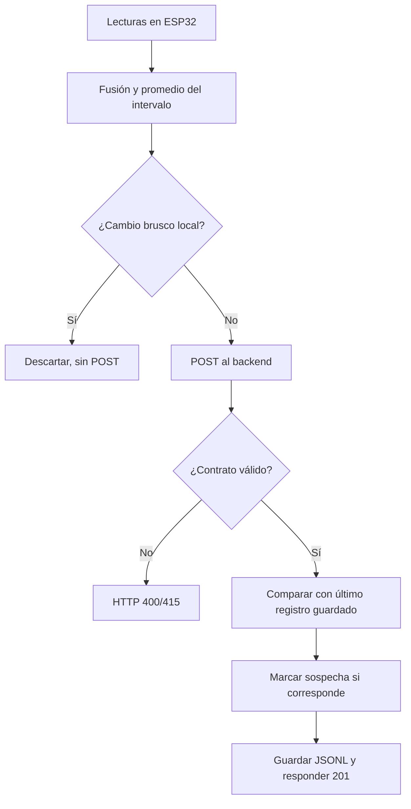

# 06 · Reglas de medición, validación y anomalías

El sistema aplica fusión de sensores, un filtro previo al envío y validación en el servidor. Estas reglas son heurísticas y requieren comparación con instrumentos de referencia para evaluar su efecto sobre las mediciones.

## 1. Fusión y estimación (firmware)

- Para **temperatura**, se promedian sensores válidos si hay al menos dos y el rango máximo−mínimo es **≤2 °C**. Si el rango supera eso, se elige el primero disponible según **SCD4x → BME280 → DHT22**.
- Para **humedad**, se usa la misma regla con un rango máximo−mínimo **≤10 puntos porcentuales de humedad relativa** y la misma prioridad.
- En la opción de media, `incertidumbre = rango/2`; cuando se elige un sensor, el código usa valores base aproximados: temperatura **0,8 / 0,5 / 1,0 °C** para SCD4x/BME280/DHT22, y humedad **3 / 3 / 5 puntos porcentuales** respectivamente.
- Presión: media BME280 en el intervalo. CO₂: media SCD4x redondeada; en ausencia de muestras, el código emite `0` para CO₂.

Estos valores de 'incertidumbre' describen una **heurística del sketch**; no proceden de una caracterización metrológica del montaje.

## 2. Filtro del ESP32 (antes del POST)

Compara el lote fusionado con la última referencia _aceptada por el propio firmware_. Si se cumple alguno de los siguientes saltos absolutos, **descarta el lote completo** y reinicia acumuladores:

| Magnitud    |                               Salto que provoca descarte |
| ----------- | -------------------------------------------------------: |
| Temperatura |                                                    ≥5 °C |
| Humedad     |                                  ≥15 puntos porcentuales |
| Presión     |                                                   ≥5 hPa |
| CO₂         | ≥400 ppm, solo si actual y anterior son mayores que cero |

Este descarte no marca un registro en JSONL: **no llega un registro al servidor**. Además, la referencia interna puede actualizarse después de un envío fallido, porque la aceptación del filtro no depende de una confirmación HTTP exitosa; eso también puede afectar qué saltos se observan después.

## 3. Validación y marca del servidor

La validación Express comprueba presencia de cuatro claves, valores numéricos finitos o `null`, rangos y ausencia de campos desconocidos. Si pasa, el backend compara contra **su última medición almacenada** con los mismos cuatro umbrales. Cuando hay salto, **conserva** la medición y añade `sospechosa:true` con motivos; no la descarta. El firmware y el backend pueden usar referencias distintas si hay pérdidas de red o intentos de otro cliente.

### Alcance de las reglas

Los saltos son indicadores heurísticos. No detectan automáticamente fallos por sesgo sistemático, deriva, ubicación deficiente o montaje incorrecto. Tampoco demuestran que una variación ambiental marcada sea imposible. Un valor `null`, un CO₂ 0 o ausencia de GPS necesitan interpretación explícita; no deben reemplazarse por ceros visuales que aparenten una lectura real.

Fuentes de código: [`EstacionMeteorologica.ino`](../../firmware/EstacionMeteorologica/EstacionMeteorologica.ino), [`config.h`](../../firmware/EstacionMeteorologica/config.h), [`validation.js`](../../backend/src/validation.js), [`anomalias.js`](../../backend/src/anomalias.js).
